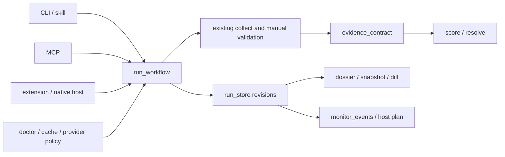

# Воспроизводимая проверка: согласованный полный объём

Дата: 2026-10-16. База исследования: `3e06046995860b5360df5dd3a6110bd7108d36a3`. План: [agent-workflow](../plans/2026-10-16-agent-workflow/README.md). Это спецификация реализации, не утверждение о готовности ПО или результатах пилота.

## Цель и границы

Агент завершает одну локальную проверку между CLI, MCP и расширением: видит готовность выбранного профиля, собирает данные, сохраняет run, получает конкретные ручные задания, продолжает после перезапуска и получает документ/снимок по тем же данным. Все решающие утверждения трассируются, неизвестность, время и неприменимость сохраняются до текста ответа. В полный объём входят мониторинговые события, PDF/OCR и выбор стороны, политика провайдеров, сравнение, объяснимый граф, оценка настоящего резолвера, replay и поставляемые артефакты.

Python >=3.10; `dependencies = []` у ядра; MCP остаётся `>=1.30,<2`. Сохраняются существующие ключи JSON, одноразовые вызовы и русские сообщения. Новые метаданные добавляются рядом. SDK2, протокольные Tasks, SaaS, сервер, обязательная БД и daemon не требуются. Собственные банковские финансовые модели, новые реестры и универсальная вероятность дефолта не входят. Применимость и честный отказ для специальных форм входят.

## Текущее устройство и минимальные изменения

`scripts/` поставляется плоскими модулями через `pyproject.toml`, MCP из `mcp/` как `inn_check_ru_mcp`, JSON-ресурсы через `inn_check_ru_data`. Сохраняем это устройство. `fetch_counterparty.collect(inn, профиль=None, режим="полный", opener=None)` собирает; `fin_scoring.score(data)` считает; `profiles.resolve(fetch_json, fin_json, profile_id, profiles=None)` решает; `manual_block.вклеить(fetch, блоки)` проверяет ручные блоки; `snapshot.fingerprint(result, дата=None)` строит отпечаток; `dossier.собрать` строит модель документа.

Новые модули не дублируют парсеры и бизнес-правила:

| Файл | Ответственность |
|---|---|
| `scripts/evidence_contract.py` | TypedDict-контракт, происхождение, время, применимость, конфликты и связь с решением |
| `scripts/run_store.py` | Только безопасное локальное хранение, immutable revisions, atomic HEAD и CAS |
| `scripts/run_workflow.py` | Оркестрация существующих операций и pending actions |
| `scripts/workflow_cli.py` | argparse и JSON/текстовый вывод; entry point `inn-check-workflow` |
| `scripts/cache_policy.py` | Чистое чтение кэшей, план и политики; вызов существующих обновляторов |
| `scripts/workflow_doctor.py` | Установленные ресурсы, профиль, SDK, сеть только по probe |
| `scripts/monitor_events.py` | Локальная очередь, lease/ack/retry и план для хоста |
| `scripts/document_input.py` | Опциональный PDF/OCR и разрешение роли поверх extract_inn |
| `scripts/provider_policy.py` | Разрешения полей, бюджет, fallback, экспорт |
| `scripts/compare_counterparties.py` | Сравнение сохранённых runs с одинаковой целью |
| `scripts/historical_replay.py` | Два режима истории, cutoff, manifest, без сети |
| `scripts/workflow_metrics.py` | Добровольные локальные события использования и агрегаты |

`data/evidence_policy.json`, `data/cache_policy.json`, `data/provider_policy.schema.json` и `data/workflow_capabilities.json` — поставляемые ресурсы. Не создавать универсальный plugin engine, ORM, event bus или второй набор профилей. Разделять `evidence_contract.py` только при фактическом росте, сохраняя публичные функции.



## Версии и форматы

`schema_version` у нового envelope и `_evidence.schema_version` — целое `1`. Версия движка берётся из существующего канона версии пакета. `rules_version` — SHA-256 canonical JSON профилей, порогов и evidence policy, не ручная копия номера релиза. Manifest отдельно хранит версии нормализатора и каталога источников. Незнакомая major/schema version отвергается с `unsupported_schema`; старые JSON читаются через явно помеченный адаптер `legacy_untraced`, а не получают вымышленные ссылки.

Новый envelope содержит `schema_version`, `status`, `run_id` (nullable), `revision` (nullable), `data` (legacy output), `error` (nullable), `warnings`, `pending_actions`. `status` принимает `ok`, `partial`, `needs_input`, `cancelled`, `error`; это состояние операции, не оценка контрагента. Ошибка содержит только `code`, безопасное русское `message`, `retryable`. Нормальные неполные данные имеют `partial`, найденный риск не является транспортной ошибкой. Старые MCP-функции сохраняют старую форму, добавляя `_workflow`, `_evidence`, `_decision` где уместно; новые функции используют envelope. CLI exit: 0 — корректный результат, включая partial/needs_input; 2 — ввод/конфигурация; 1 — ошибка выполнения; 130 — отмена. stdout содержит один JSON, stderr — диагностику.

## Evidence и решение

`_evidence = {schema_version, claims, conflicts, applicability, rules_version}`. `claims` — словарь `claim_id -> Claim`; ключ стабилен в пределах одной ревизии и детерминирован по subject/field/source/raw digest/locator/period/transformation. Порядок провайдеров не влияет на смысл конфликтов. Поля Claim:

```json
{
  "claim_id": "sha256:...", "subject_inn": "7707083893",
  "field": "дампы_фнс.численность_сотрудников", "value": 0, "unit": "person",
  "knowledge": "known", "reason_code": null,
  "source_id": "дампы_фнс", "origin_family": "fns_staff",
  "upstream_dataset": "fns_staff_2025", "relation": "primary",
  "raw_ref": {"response_id": "r1", "sha256": "...", "locator": "/records/0/staff", "availability": "available"},
  "retrieved_at": "2026-10-16T09:00:00Z", "published_at": null,
  "first_observed_at": "2026-10-16T09:00:00Z", "effective_at": null,
  "period": {"start": "2025-01-01", "end": "2025-12-31"},
  "valid_until": null, "freshness_policy": "annual_staff_v1",
  "transformation": "integer_v1", "depends_on": [],
  "search_scope": null, "coverage_complete": null
}
```

`knowledge`: `known|unknown|not_applicable|conflict`. Причины: `source_unavailable`, `schema_invalid`, `not_disclosed`, `coverage_incomplete`, `missing_required_field`, `stale`, `period_mismatch`, `revision_unknown`, `not_measurable_for_form`, `raw_unavailable`, `unsupported_form`, `budget_exhausted`. Отсутствие raw не отменяет наблюдаемое значение, но явно ограничивает проверяемость и не получает фиктивный hash. Проверенное отрицание требует subject, query scope и полноту; `None`, обрезанная пагинация или пустой транспортный ответ не являются отрицанием. Ручное наблюдение имеет `relation="manual_observation"`, ссылку на блок и вложение, а не присвоенную достоверность госисточника.

Вычисленный Claim ссылается на все входы `depends_on`; транзит требует выручку и численность с сопоставимыми периодами/единицами. Минимальная миграция — статус, недостоверность, банкротство с ролью, долг (текущий/погашенный), капитал, выручка, численность, санкции и все листы решающих сигналов профилей. Полный объём фазы 1 покрывает каждый путь `data/profiles_ru.json` и вычисленные финансовые правила, не только демонстрационные пять полей.

Неизвестное семейство не считается независимым. Разные значения одного поля одного сопоставимого периода дают conflict со всеми claim ids, причиной решения и `selected_claim_id` либо null. Для разных периодов сохраняется история; новое опубликованное значение не автоматически опровергает старое. Конфликт критичного листа блокирует утверждение отсутствия риска. Разрешение человеком создаёт новую ревизию с причиной и ссылками, не удаляет исходные значения.

UTC ISO 8601 для моментов, ISO date для периода. `retrieved_at` не заменяет `published_at/effective_at`. Будущие метаданные паспорта хранятся raw, не входят в known-at. TTL применяется по типу утверждения; устаревшее отрицание становится unknown для текущего решения; подтверждённое историческое положительное событие не стирается. Неизвестная дата остаётся null. Срок хранения run независим от TTL факта.

Applicability содержит `subject_type`, `reporting_form`, `form_version`, `form_evidence_ids`, `source_coverage`, `rules`. Правило имеет `applicable|not_applicable|unknown` и reason. Упрощённая форма не обязана иметь полный баланс; ИП, банк, НКО и ограниченный доступ получают корректный знаменатель покрытия. По одному ОКВЭД форму не угадывать; без проверенного паспорта формы — `unsupported_form`, без новых банковских порогов.

`_decision` содержит `schema_version`, `rules_version`, `decision_status` (`supported|insufficient_evidence|facts_only`), `can_recommend`, `missing_evidence`, `next_checks`, `claim_ids`, `coverage` с числителем/знаменателем применимых обязательных правил. Это не вероятность дефолта. `нейтрально` сохраняет `facts_only`, `can_recommend=false`. Текст рекомендации строится только по проверенным claim ids; unknown не превращается в «не массовый» или «долгов нет».

Публичные функции (словари имеют приведённые схемы; stdlib TypedDict используется для документации и тестов):

```python
def enrich(fetch: dict, *, now: str, raw_refs: dict | None = None) -> dict: ...
def evaluate(fetch: dict, *, profile: str, now: str) -> dict: ...
def validate_evidence(fetch: dict) -> list[dict]: ...
```

`enrich` возвращает глубокую копию legacy fetch с `_evidence` и не вычисляет финансовые правила. `evaluate` возвращает ровно materialized result:

```python
{
    "fetch": enriched_fetch,
    "fin": fin_scoring.score(enriched_fetch),
    "assessment": profiles.resolve(enriched_fetch, fin, profile),
    "metadata": {
        "schema_version": 1,
        "engine_version": engine_version,
        "rules_version": rules_sha256,
        "evaluated_at": now,
        "decision": decision_metadata,
    },
}
```

Здесь `fin` во втором вызове означает уже полученный результат score, не повторный расчёт. `fetch["_decision"]` и `assessment["_decision"]` — одинаковая копия `metadata["decision"]`. `fin["оценки_сигналов"]`/`fin["версия_оценок"]=1` из Phase 0 остаются авторитетными: новый слой только привязывает зависимости к их статусам, не вычисляет параллельные признаки. Год/источник численности из Phase 0 переносятся без замены датой запроса. Existing API score/resolve сами используют нормализованный evidence при его наличии, legacy callers проходят тот же адаптер. Нельзя построить параллельный резолвер с иными правилами или рекурсивно вызвать evaluate из resolve.

## Run store и возобновление

Корень: `INN_CHECK_RUNS_DIR`, иначе `~/.local/share/inn-check-ru/runs`; `--store` задаёт его только локальный CLI/конфигурация хоста. MCP и страница не передают путь. run id — canonical UUID4, revision — положительное целое. `read` ничего не создаёт. Запрещены traversal, absolute ids, symlink по цепочке. Секреты и произвольное environment не сериализуются. Перед persist использовать существующую canonical redaction из snapshot/evidence_pack: удалить `_token_pb`, auth headers, API keys и proxy credentials рекурсивно; тестировать контрольными секретами, не полагаться только на имена ключей.

```text
<root>/<run_id>/HEAD.json
<root>/<run_id>/revisions/000001.json
<root>/<run_id>/revisions/000002.json
<root>/<run_id>/artifacts/<generated-id>.md
<root>/<run_id>/raw/<content-sha256>
```

Ревизия содержит `schema_version, run_id, revision, parent_revision, created_at, subject_inn, profile, workflow_status, payload, operation_id, manifest, artifacts`. `payload` содержит ровно materialized result `{fetch, fin, assessment, metadata}` из evaluate; `manifest` — sha256 входа, raw refs, versions, cutoff и hash предыдущей ревизии. HEAD хранит revision и digest. Запись: exclusive lock → compare expected revision → temp/fsync → replace revision → replace HEAD → unlock. Crash до HEAD оставляет orphan, который read не выбирает автоматически. Проверка digest на чтении обязательна. Блокировка stdlib ОС (`fcntl`/`msvcrt`) автоматически освобождается после смерти; не удалять живую чужую блокировку по одному возрасту. На NFS гарантия не заявляется. Размер JSON ограничен 32 MiB; raw хранится отдельно.

`operation_id` UUID задаёт идемпотентность в пределах run: повтор тех же байтов возвращает сохранённую ревизию; те же id с другим digest даёт `operation_conflict`. Два writers с одним expected_revision: один succeeds, второй `revision_conflict`. Operation index восстанавливается из committed revisions, не отдельный неатомарный источник истины. Старт с сетью сначала создаёт `collecting` ревизию; завершение/отмена добавляет terminal revision, сохраняя доступные результаты. После kill следующий resume показывает `interrupted`, а не самовольно начинает сеть.

```python
def create(payload: dict, *, root=None, now=None) -> dict: ...
def read(run_id: str, *, revision: int | None = None, root=None) -> dict: ...
def append(run_id: str, payload: dict, *, expected_revision: int,
           operation_id: str, root=None, now=None) -> dict: ...
```

Workflow adapter возвращает envelope; storage-функции возвращают revision record и поднимают `RunStoreError(code, message)` для границы CLI/MCP. Workflow APIs:

```python
def start(inn: str, *, profile="нейтрально", mode="полный", root=None) -> dict: ...
def resume(run_id: str, *, root=None) -> dict: ...
def import_manual(run_id: str, blocks: dict, *, expected_revision: int,
                  operation_id: str, root=None) -> dict: ...
def refresh(run_id: str, source_ids: list[str], *, expected_revision: int,
            operation_id: str, root=None) -> dict: ...
def render(run_id: str, *, format="markdown", revision=None, root=None) -> dict: ...
def export(run_id: str, *, format="markdown", revision=None, root=None) -> dict: ...
def save_snapshot(run_id: str, *, revision=None, root=None) -> dict: ...
```

`resume`, `render` не делают сеть/запись; render markdown возвращает текст, JSON модель документа; DOCX только export. `export` пишет под управляемым artifacts, фиксирует digest и origin revision в отдельной artifact registry с atomic append; не изменяет исходный evidence pack. `refresh` принимает только source ids из реестра; вызывает источник и его необходимые prerequisites, явно перечисляет фактически обновлённые источники, не всю collect. Новый start захватывает реальные ответы через существующие `_записать`/`evidence_pack.записать_пакет`, переносит content hashes и response ids в raw refs. Locator присваивается лишь после проверки, что он разрешается в конкретном сохранённом ответе и даёт вход преобразования; догаданные пути запрещены. Неподдержанный locator имеет null и raw_unavailable/unmapped_locator с объяснением. Сбор остаётся ограничен 120s/4 потоками, batch 3 concurrent, graph <=25 requests.

`pending_actions`: `action_id, run_id, revision, kind, source_id, reason_code, url, query, required_fields, expires_at, available, unavailable_reason`. `kind`: manual/key/cache/network/refresh/resolve_conflict. URL allowlist реестра, query содержит нужный ИНН, не произвольный shell. Вручную разрешены результаты `completed|declined|incomplete`; каждый сохраняется, только полный валидный блок закрывает gap. Chrome явно показывает INN+profile+revision до привязки, повторяется native-host проверка даты/URL/subject. Будущая дата наблюдения и явно истёкший expires_at отвергаются; сам возраст наблюдения без указанного срока не создаёт вымышленный TTL. Дата с точностью до дня хранится как declared observation с precision=day, а не как доказанный точный UTC-момент публикации. Явный declined сохраняется и при неполной пагинации. Отказ и неполная пагинация не дают clean conclusion.

## Cache, providers и побочные эффекты

`cache_policy.status(profile, *, now, root=None)->dict` без сети/записи; `plan(profile, *, now, root=None)->dict`; `execute(dataset_ids, *, profile, max_bytes, timeout_seconds, root=None)->dict`. plan содержит missing/stale/unknown, даты публикации/загрузки, TTL, next_due_at, estim_bytes nullable с unknown reason, сеть, зависимости и argv-массивы. Данные без обоснованного TTL не получают придуманную свежесть; возвращают policy_unknown. Для санкций <=7 дней, запас обновления 1 день; probe 24 часа и привязка к сети. Перенос существующих TTL требует тестов каждого набора. Download в staging, validate и atomic swap; прерванная загрузка оставляет last-known-good. Очистка результатов отдельная явная команда, не часть status.

`workflow_doctor.inspect(profile="нейтрально", *, probe=False, now=None)->dict` работает из wheel без SDK. Разделы installation/core/sdk/cache/automatic/manual/optional/network, readiness и next actions. SDK проверяет FastMCP импорт и диапазон, отсутствие optional key не блокирует базовый сценарий. probe явно включает сеть и запись probe cache. Вывод никогда не содержит значения ключей, proxy credentials, environment или raw exception URL.

Provider policy имеет schema_version, providers с allowed_fields, export_fields, request_limit, request_cost_units (целое), total_cost_units, fallback_on, enabled. Денежную цену без настроенного тарифа не выдумывать. Перед запросом резервировать бюджет, при timeout списанный запрос не возвращать автоматически. Только явная настройка разрешает передачу ИНН другому поставщику; отсутствие policy сохраняет прежний одиночный выбор ключа без автоматического fallback. 401/403 не повторять; 429 не штурмовать; max retries=1 только в общем бюджете при допустимой transient причине. Досье/evidence export фильтруются по экспортной политике, запрещённое поле не утечёт через raw/лог/graph. Пользовательская policy не является доказательством прав поставщика.

MCP annotations статические по максимальным эффектам: legacy fetch(save optional) не readOnly; access_check пишет probe cache; run start/import/refresh/export/snapshot и event ack write local. Чистые run read/render/compare/cache status/doctor без probe readOnly. Инструмент с optional записью помечается writable либо разделяется на read/write. openWorld отражает сетевое обращение, annotations не заменяют проверки. Cancellation должна прекращать descendants и фиксировать interrupted/cancelled run; нет секретов в stderr. Вызовы без export не создают документы.

## Мониторинг, документы, сравнение

Событие: `event_id, schema_version, subject_inn, profile, from_revision, to_revision, kind, change_digest, observed_at, data, delivery`. kind: `company_changed|coverage_lost|refresh_failed|coverage_restored`. ID — hash канонических subject/profile/revision-pair/kind/change; повтор ingest не дублирует. Очередь локальная, atomic/CAS. `list_events(*, state="pending", limit=50, root=None)`, `claim_events(consumer_id, *, limit=50, lease_seconds=300, root=None)`, `ack_events(event_ids, *, consumer_id, root=None)`, `retry_events(event_ids, *, consumer_id, root=None)`; чтение не означает доставку. at-least-once + idempotency по event_id, не обещать exactly-once внешней сети. Ack повторяем; crash до ack возвращает событие после lease. Receipt состояния delivered/acknowledged различаются. Host plan JSON и cron/launchd/Windows Task Scheduler XML печатаются, не устанавливаются. XML экранирует command/arguments и задаёт timeout, multiple-instance policy и ограниченный retry. Пример n8n импортируется по желанию, не содержит секретов и не отправляет уведомления без настройки.

PDF extra даёт текстовый PDF через `pypdf`; OCR использует явно установленный локальный Tesseract и renderer (версии/команды проверяются doctor). Без extra — structured optional_dependency_missing. Никакой облачной передачи. Лимиты: 20 MiB, 100 страниц, 60s extraction budget; зашифрованный/битый файл — явный отказ. OCR не исправляет контрольные цифры догадкой. Кандидаты хранят контекст, page, offsets, role hints, КПП/ОГРН/адрес. Выбор `supplier|buyer|own_company|bank|signatory|unknown` требует явного selection при нескольких кандидатах/неуверенной роли, особенно own_company/bank; до выбора сбор не начинается. Интерфейс `extract(data: bytes, *, filename: str, ocr=False)->dict`, `select(candidates: list[dict], *, role: str, candidate_id: str | None = None)->dict`.

`compare_counterparties.compare(run_ids: list[str], *, as_of: str, root=None)->dict` принимает 2–5 разных субъектов, один профиль; mismatch профиля отвергает, as_of использует только доступные на cutoff ревизии. Видны дата каждого факта, покрытие, причины unknown и одинаковая таблица критериев. Не сортировать unknown как низкий риск. Различать экономическую цель и факт рекомендации. Граф расширяет существующие рёбра `edge_type, evidence_ids, effective_at, origin_family`; типы ownership/director/address/cofounder не взаимозаменяемы. `unexplored` хранит frontier и stop_reason (budget/depth/unavailable). Адрес сам по себе не доказывает владельца.

## Replay, оценка и реальные эксперименты

`historical_replay.replay(run_id, *, mode, cutoff, root=None)->dict`: `original` возвращает прежнее решение и manifest без пересчёта; `current_rules` считает новые правила на неизменённых старых данных в новом artifact manifest, не перезаписывает старое. Только `published_at` с подтверждённой семантикой либо `first_observed_at <= cutoff` допускает claim в point-in-time режим; неизвестная редакция исключается/помечается, не получает прежнюю дату из period. Поздняя корректировка сохраняется новой версией. Реальные датированные пары являются отдельным evidence, синтетика подтверждает только механизм.

Оценка A вызывает настоящий score/resolve и CLI/MCP/dossier. Метрики: unsupported/contradicted/asserted claims, false green при обязательном unknown, abstention и причины, coverage с denominator, latency, запросы, manual steps. Целевой adversarial корпус и репрезентативный набор разделены. Rubric и hashes фиксируются до прогона; эталонные отрицания требуют scope/completeness. Missing oracle исключается со счётчиком, не считается success. Mutation tests должны выявлять намеренные unknown→absent и lost-provenance дефекты.

Оценка B требует отдельной временной выборки, frozen engine/thresholds до исходов, disjoint ИНН и учёта групп; события «заявлено дело», «процедура», «ликвидация», «убыток клиента» раздельны. Незрелый горизонт censoring, не survived. Размер по заданной ширине ДИ/числу событий, attrition/weights опубликованы. Нельзя исполнением программы создать реальные outcome labels или независимых reviewers.

Добровольные local-only metrics выключены по умолчанию: session pseudonym, stage, duration_active/waiting, manual steps, completion/dropoff reason; без ИНН/документа/ключей. Восемь наблюдаемых интервью, четырёхнедельный пилот; отдельно 10 установок с целью 8 самостоятельных объяснений next step, 5 manual-resume сценариев, 20 разрешённых обезличенных документов, 3 независимых повторных использования. Это критерии экспериментов, не статистические гарантии. Инструментарий/протокол можно завершить программно; E-HUMAN/E-OUTCOME/E-ORACLE остаются `awaiting_external_evidence` до фактических результатов. Отсутствующие внешние данные не маскируются созданными синтетическими записями.

## Решения и альтернативы

| Решение | Плюсы | Минусы | Альтернатива и причина отказа |
|---|---|---|---|
| Additive sidecar | Сохраняет клиентов и текущие JSON | Legacy надо честно адаптировать | Оборачивать каждое поле ломает совместимость |
| JSON revisions + OS lock | Stdlib, прозрачное чтение и копирование | Локальная файловая система; без multi-host concurrency | SQLite вводить только после измеренного bottleneck |
| Отдельный workflow CLI | Не меняет синтаксис inn-check-ru | Ещё одна документируемая команда | Переписывание всех entry points создаёт ненужную миграцию |
| Host-owned scheduling | Работает с разными агентами, без daemon | Доставка зависит от настроек хоста | Встроенная рассылка создаёт новые секреты/эксплуатацию |
| Optional PDF/OCR | Минимальное ядро сохранено | Extra/system binary требуют диагностики | Mandatory OCR замедляет любую установку |
| Policy-before-fallback | Управляемые расходы и передачи | Меньше скрытой автоматизации | Автоперебор всех ключей неожиданно расходует квоты |
| Отдельные software/empirical gates | Честная проверка достижения | Часть итогов ждёт людей/время | Заменить пилот unit tests нельзя |

## Приёмка и эксплуатация

Полный software gate: clean wheel/ZIP install → doctor/cache plan → fixture-backed start → новый процесс → extension/native manual bind → resume без сети → dossier/snapshot → refresh selected source → diff/event → ack/retry → historical replay; Linux/macOS/Windows и Python 3.10/3.12. Реальные браузер/native host/MCP host сессии регистрируются отдельно от headless протокольных tests. Артефакты проходят secret sentinels, schema/version parity, digest checks. Live canary хранит географию, сеть, пропуски отдельно от offline pass.

Релизный откат — предыдущая версия пакета; новые stores остаются, старый клиент отказывает unknown schema без порчи. Backup: остановить writers/взять согласованный HEAD, скопировать каталог, проверить manifests и raw hashes в чистом каталоге; восстановления доказательств без исходных raw не обещать. Логи локальные и без секретов; задержки/покрытие/ошибки агрегируются, не превращаются в скрытую телеметрию. Публикация/включение расписаний/внешние уведомления — отдельные действия, план их не выполняет.
